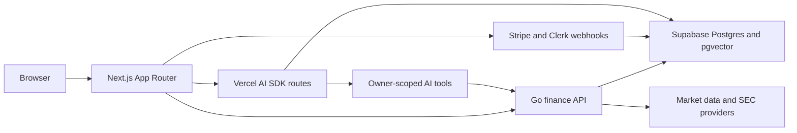

# AI Financial Intelligence Workspace

Recruiter-grade fintech/wealthtech product build for an AI financial research and portfolio decision-support workspace.

This project is not a trading bot, brokerage product, robo-advisor, return-prediction engine, or personalized investment advice system. The product helps users research assets, understand portfolio risk, compare scenarios, review goals, and save cited AI-assisted briefs.

[Open the public guided demo](https://ai-finance-two-bice.vercel.app/demo) · The demo is read-only and uses fictional sample data; the owner-scoped workspace remains sign-in protected.

## Current Status

Phase 9 local completion is done. The active roadmap priority is the Product Simplification Track: the primary experience is **Overview → Markets → Portfolio → Plan → Learn**. Research, evaluation, risk, and account tools remain supporting capabilities.

- **Markets** brings supported asset classes into one searchable monitor with provider coverage and freshness visible.
- **Portfolio** shows owner-scoped holdings, allocation, concentration, and provider-backed market data.
- **Plan** supports goal and contribution scenarios with assumptions disclosed.
- **Learn** connects the education curriculum to market and planning workflows.
- The supporting research workspace retains private document upload, cited analysis, human review, and reviewed export.
- The Go API, Supabase migrations, OpenAPI contract, AI safety fixtures, and deployment artifacts remain part of the engineering foundation. See the [master roadmap](docs/MASTER_EXECUTION_ROADMAP.md) for phase status and remaining environment-dependent work.

External model calls remain disabled by default. The public guided demo is read-only and uses fictional sample data; the owner-scoped workspace requires sign-in.

Current AI working mode:
- Deterministic fixture mode is the default for local development and review.
- Vercel AI Gateway calls are intentionally skipped by the local Phase 5 verifier so development is not blocked by account billing or credit-card requirements.
- Direct OpenAI is wired as the dormant live-provider path, but all external model calls stay disabled unless `AI_EXTERNAL_CALLS_ENABLED=true` is explicitly set.

## Product Direction

Working name: Aperture Financial Intelligence.

The product is a premium AI finance workspace for portfolio-aware research, SEC filing summaries, watchlist monitoring, goal scenario planning, and risk explanation. AI outputs must include data freshness, assumptions, citations when available, and a not-financial-advice boundary.

## Planned Stack

- Next.js App Router, TypeScript, Tailwind CSS, shadcn/ui
- Clerk for auth
- Supabase Postgres, SQL migrations, `pgvector`
- Go service for finance/data APIs, `pgx`, `sqlc`, OpenAPI
- Vercel AI SDK with optional Vercel AI Gateway only after paid API usage is explicitly enabled
- Optional direct OpenAI provider through `@ai-sdk/openai`
- Stripe Billing
- Upstash Redis
- Resend
- PostHog and Sentry
- Vercel for Next.js, Cloudflare at the edge, container hosting for Go API

## Source Of Truth

Read these before implementation:
1. [Master execution roadmap](docs/MASTER_EXECUTION_ROADMAP.md)
2. [Implementation spec](AIFinancialIntelligenceWorkspacePlan.md)
3. [AI integration setup](docs/AI_INTEGRATION_AND_DEV_SETUP.md)
4. [Backend decision](docs/BACKEND_DECISION.md)
5. [Markdown docs plan](AIProjectMarkdownDocsPlan.md)

## Documentation Map

- [Product spec](docs/PRODUCT_SPEC.md)
- [Implementation plan](docs/IMPLEMENTATION_PLAN.md)
- [Architecture](docs/ARCHITECTURE.md)
- [Mobile app scope and architecture](docs/MOBILE_APP_PLAN.md)
- [Database schema](docs/DATABASE_SCHEMA.md)
- [API spec](docs/API_SPEC.md)
- [AI features](docs/AI_FEATURES.md)
- [Design system](docs/DESIGN_SYSTEM.md)
- [Security and compliance](docs/SECURITY_AND_COMPLIANCE.md)
- [Testing strategy](docs/TESTING_STRATEGY.md)
- [Environment](docs/ENVIRONMENT.md)
- [Brand and media notes](docs/BRAND_AND_MEDIA.md)
- [Portfolio case study](docs/PORTFOLIO_CASE_STUDY.md)
- [Demo walkthrough script](docs/DEMO_WALKTHROUGH.md)

## Architecture At A Glance



Browsers generally talk to Next.js. Next.js server code and AI tools call the Go API for authoritative portfolio, market-data, and ownership-checked finance behavior. Model calls remain disabled by default until explicitly enabled.

## Workflow Scripts

```bash
scripts/dev-local
scripts/generate-openapi-client
scripts/validate-supabase-migrations
scripts/run-ai-evals
scripts/check-ai-safety-fixtures
scripts/verify-phase5-live
scripts/verify-phase7-security
scripts/verify-accessibility-contracts
scripts/verify-deployment-artifacts
scripts/verify-evidence-workspace-e2e
```

## Local Development

Use the combined local runner for portfolio and AI work. It starts the Go finance API with `services/api/.env`, waits for `/v1/health`, then starts or reuses the Next.js dev server.

```bash
scripts/dev-local
```

Manual web-only startup is available for marketing routes and UI work. The integrated workspace needs the API and document worker started by `scripts/dev-local`.

```bash
cd apps/web
npm run dev -- -p 3020
```

The Phase 5 portfolio brief route lives in `apps/web` and calls the Go API for owner-scoped portfolio context.

```bash
scripts/dev-local
curl -X POST http://127.0.0.1:3020/api/ai/portfolio-brief \
  -H "Authorization: Bearer dev:user_demo" \
  -H "Content-Type: application/json" \
  -d '{"prompt":"Summarize concentration risk and data freshness as research."}'
```

The Phase 5 verifier intentionally skips Vercel AI Gateway and runs the
deterministic fixture path against an owner-scoped finance API snapshot:

```bash
scripts/verify-phase5-live
```

Local development defaults to deterministic fixture mode even when an AI Gateway
or OpenAI key is present. Set `AI_EXTERNAL_CALLS_ENABLED=true` and
`AI_PORTFOLIO_BRIEF_MODE=live` only when manually testing the route outside the
verifier with an explicit live provider.

Document research defaults to in-memory metadata plus private local files during
development. The API runs an embedded processor in that mode:

```bash
RESEARCH_PERSISTENCE_MODE=memory
DOCUMENT_STORAGE_MODE=local
DOCUMENT_STORAGE_DIR=./var/research-documents
scripts/dev-local
```

For the durable local path, start Supabase, apply pending migrations, set
`RESEARCH_PERSISTENCE_MODE=postgres`, then run the API and worker separately:

```bash
supabase start
supabase migration up --local

# Terminal 1
cd services/api
set -a; source .env; set +a
go run ./cmd/api

# Terminal 2
cd services/api
set -a; source .env; set +a
go run ./cmd/worker
```

Production uses Postgres persistence and the private `research-documents`
Supabase Storage bucket. `SUPABASE_SERVICE_ROLE_KEY` remains server-only and must
never use a `NEXT_PUBLIC_` prefix.

## Local Demo Path

1. Open `/` and confirm Aperture is framed as financial research and planning support.
2. Open `/app` for the current overview, portfolio state, and data freshness.
3. Open `/app/monitors` to search supported markets and inspect provider coverage, confirmed monitor states, and limitations.
4. Open `/app/portfolio` to review owner-scoped holdings, allocation, concentration, and provider data.
5. Open `/app/goals` (Plan) to review a goal scenario and its assumptions, then `/app/learn` for contextual education.
6. For the supporting research workflow, open `/app/research` to inspect private source upload, cited analysis, human review, and reviewed export.
7. Follow the [demo walkthrough](docs/DEMO_WALKTHROUGH.md) for the presentation and verification notes.

## Recruiter Case Study

The portfolio story is documented in [docs/PORTFOLIO_CASE_STUDY.md](docs/PORTFOLIO_CASE_STUDY.md). It covers the product boundary, architecture tradeoffs, AI safety posture, backend ownership checks, billing/security implementation, verification commands, and remaining live-environment hardening.

## License

No license file is included. The source is available for portfolio review, but
reuse, redistribution, and derivative works are not granted unless a license is
added later.
