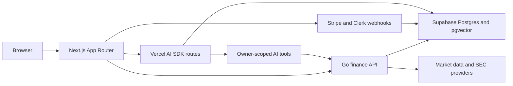

# AI Financial Intelligence Workspace

Recruiter-grade fintech/wealthtech product build for an AI financial research and portfolio decision-support workspace.

This project is not a trading bot, brokerage product, robo-advisor, return-prediction engine, or personalized investment advice system. The product helps users research assets, understand portfolio risk, compare scenarios, review goals, and save cited AI-assisted briefs.

## Current Status

Roadmap phase: Phase 9 is queued next: Completion And No-Placeholder Pass. Phase 8 local case-study polish exists, but the project is not portfolio-ready while linked routes still contain unfinished or fixture-only surfaces. Public deployment, live Stripe/Clerk webhook delivery, remote Supabase persistence checks, and paid live AI/provider verification remain environment-dependent follow-on work.

Phase 0 control-plane assets through Phase 8 local polish are in place:
- [Agent instructions](AGENTS.md)
- [Master execution roadmap](docs/MASTER_EXECUTION_ROADMAP.md)
- [AI integration and development setup](docs/AI_INTEGRATION_AND_DEV_SETUP.md)
- [Backend decision](docs/BACKEND_DECISION.md)
- [Repo-local AI skills](ai-dev/skills)
- Go API service in [services/api](services/api)
- OpenAPI contract and generated TypeScript client in [packages/contracts](packages/contracts)
- Supabase migrations in [supabase/migrations](supabase/migrations)
- Deterministic workflow scripts in [scripts](scripts)
- Owner-scoped portfolio/watchlist API flows with real provider market-data metadata
- Portfolio workspace UI with provider-backed portfolio creation, holdings, transactions, allocation review, and decision-support disclaimers
- AI SDK portfolio brief route with disabled-by-default external provider configuration, owner-scoped `getPortfolioSnapshot` tool wrapper, structured output schema, citations/freshness contract, Supabase persistence path, usage tracking, and deterministic AI eval/safety scripts
- Phase 6 deterministic research, goal, and risk intelligence surfaces with citations, assumptions, safety labels, and not-financial-advice boundaries
- Phase 7 server-side entitlements, usage gates, signed webhook handlers, rate limits, audit logging, and privacy-scrubbed observability helpers
- Phase 8 local case-study package: brand/media notes, architecture diagram, walkthrough script, screenshot capture set, README updates, and API docs
- Phase 9 unfinished-surface audit in [docs/UNFINISHED_SURFACES_AUDIT.md](docs/UNFINISHED_SURFACES_AUDIT.md)

Current AI working mode:
- Deterministic fixture mode is the default for local development and review.
- Vercel AI Gateway calls are intentionally skipped by the local Phase 5 verifier so development is not blocked by account billing or credit-card requirements.
- Direct OpenAI is wired as the dormant live-provider path, but all external model calls stay disabled unless `AI_EXTERNAL_CALLS_ENABLED=true` is explicitly set.

## Product Direction

Working name: Aperture Financial Intelligence.

The product is a premium AI finance workspace for portfolio-aware research, SEC filing summaries, watchlist monitoring, goal scenario planning, and risk explanation. AI outputs must include data freshness, assumptions, citations when available, and a not-financial-advice boundary.

## Planned Stack

- Next.js App Router, TypeScript, Tailwind CSS, shadcn/ui
- Clerk for auth
- Supabase Postgres, SQL migrations, `pgvector`
- Go service for finance/data APIs, `pgx`, `sqlc`, OpenAPI
- Vercel AI SDK with optional Vercel AI Gateway only after paid API usage is explicitly enabled
- Optional direct OpenAI provider through `@ai-sdk/openai`
- Stripe Billing
- Upstash Redis
- Resend
- PostHog and Sentry
- Vercel for Next.js, Cloudflare at the edge, container hosting for Go API

## Source Of Truth

Read these before implementation:
1. [Master execution roadmap](docs/MASTER_EXECUTION_ROADMAP.md)
2. [Implementation spec](AIFinancialIntelligenceWorkspacePlan.md)
3. [AI integration setup](docs/AI_INTEGRATION_AND_DEV_SETUP.md)
4. [Backend decision](docs/BACKEND_DECISION.md)
5. [Markdown docs plan](AIProjectMarkdownDocsPlan.md)

## Documentation Map

- [Product spec](docs/PRODUCT_SPEC.md)
- [Implementation plan](docs/IMPLEMENTATION_PLAN.md)
- [Architecture](docs/ARCHITECTURE.md)
- [Database schema](docs/DATABASE_SCHEMA.md)
- [API spec](docs/API_SPEC.md)
- [AI features](docs/AI_FEATURES.md)
- [Design system](docs/DESIGN_SYSTEM.md)
- [Security and compliance](docs/SECURITY_AND_COMPLIANCE.md)
- [Testing strategy](docs/TESTING_STRATEGY.md)
- [Environment](docs/ENVIRONMENT.md)
- [Brand and media notes](docs/BRAND_AND_MEDIA.md)
- [Portfolio case study](docs/PORTFOLIO_CASE_STUDY.md)
- [Demo walkthrough script](docs/DEMO_WALKTHROUGH.md)

## Architecture At A Glance



Browsers generally talk to Next.js. Next.js server code and AI tools call the Go API for authoritative portfolio, market-data, and ownership-checked finance behavior. Model calls remain disabled by default until explicitly enabled.

## Workflow Scripts

```bash
scripts/dev-local
scripts/generate-openapi-client
scripts/validate-supabase-migrations
scripts/run-ai-evals
scripts/check-ai-safety-fixtures
scripts/verify-phase5-live
scripts/verify-phase7-security
```

## Local Development

Use the combined local runner for portfolio and AI work. It starts the Go finance API with `services/api/.env`, waits for `/v1/health`, then starts or reuses the Next.js dev server.

```bash
scripts/dev-local
```

Manual web-only startup is still available for static marketing routes that do not need finance data.

```bash
cd apps/web
npm run dev
```

The Phase 5 portfolio brief route lives in `apps/web` and calls the Go API for owner-scoped portfolio context.

```bash
scripts/dev-local
curl -X POST http://127.0.0.1:3000/api/ai/portfolio-brief \
  -H "Authorization: Bearer dev:user_demo" \
  -H "Content-Type: application/json" \
  -d '{"prompt":"Summarize concentration risk and data freshness as research."}'
```

The Phase 5 verifier intentionally skips Vercel AI Gateway and runs the
deterministic fixture path against an owner-scoped finance API snapshot:

```bash
scripts/verify-phase5-live
```

Local development defaults to deterministic fixture mode even when an AI Gateway
or OpenAI key is present. Set `AI_EXTERNAL_CALLS_ENABLED=true` and
`AI_PORTFOLIO_BRIEF_MODE=live` only when manually testing the route outside the
verifier with an explicit live provider.

## Phase 8 Demo Path

1. Open `/` and confirm the product is framed as AI financial research, not trading automation.
2. Open `/app/portfolio`, refresh provider-backed portfolio data, and inspect holdings, allocation, freshness, and the intraday chart.
3. Open `/app/research`, `/app/goals`, and `/app/risk` to review deterministic cited Phase 6 AI outputs and safety copy.
4. Open `/app/billing` to verify server-side entitlement limits and local fixture billing state.
5. Run the verification commands in [Demo walkthrough script](docs/DEMO_WALKTHROUGH.md).

## Recruiter Case Study

The portfolio story is documented in [docs/PORTFOLIO_CASE_STUDY.md](docs/PORTFOLIO_CASE_STUDY.md). It covers the product boundary, architecture tradeoffs, AI safety posture, backend ownership checks, billing/security implementation, verification commands, and remaining live-environment hardening.
