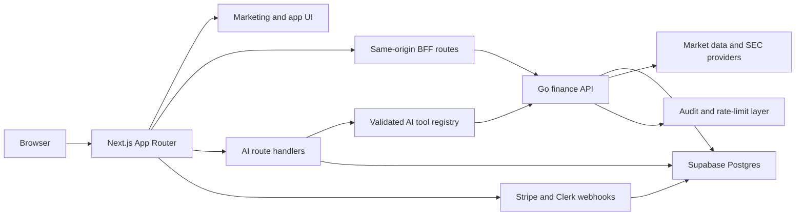

# Architecture

## System Boundary

Aperture Financial Intelligence is a research and portfolio decision-support product. It separates user-facing UI, AI orchestration, finance APIs, storage, billing, and observability so sensitive financial data is not exposed casually.

## High-Level Components

| Component | Responsibility |
| --- | --- |
| Next.js app | Marketing, authenticated UI, BFF surfaces, AI streaming UX, Stripe/Clerk webhooks |
| Go API | Finance/data APIs, calculations, market-data normalization, SEC ingestion, audit-backed mutations |
| Supabase Postgres | Relational system of record, SQL migrations, `pgvector` retrieval |
| Clerk | Authentication, user sessions, future organizations |
| Stripe | Billing, subscriptions, entitlements |
| Upstash Redis | Rate limits, provider cache, AI quota counters, idempotency keys |
| Vercel AI SDK | Streaming chat, tool calling, structured outputs, and disabled-by-default provider routing |
| PostHog/Sentry | Privacy-scrubbed product analytics and error monitoring |
| Cloudflare | DNS, WAF, security headers, bot controls |

## System Diagram



## Request Flow

1. Browser renders public routes or authenticated app routes through Next.js.
2. Clerk manages auth state and session UX.
3. Next.js server code calls the Go API with a user-authenticated context.
4. Go validates Clerk JWTs, maps Clerk subjects to internal profiles, enforces ownership and entitlements, and performs finance operations.
5. Go reads and writes Supabase Postgres through `pgx` and generated `sqlc` query code.
6. AI routes in Next.js orchestrate Vercel AI SDK tool calls against application-owned API wrappers, not raw database credentials.
7. AI outputs, tool runs, citations, usage, costs, and safety labels are persisted.

## Repository Shape

Planned:

```txt
apps/web/              Next.js App Router app
services/api/          Go finance/data API
packages/contracts/    OpenAPI spec and generated TypeScript client
supabase/migrations/   SQL migrations
scripts/               Deterministic workflow commands
ai-dev/skills/         Repo-local AI implementation skills
docs/                  Project source-of-truth docs
```

## Runtime Principles

- Browser clients generally talk to Next.js, not directly to the Go API.
- Public Go access requires Clerk JWT validation, strict CORS, rate limits, and Cloudflare controls.
- Service-role keys, provider keys, raw JWTs, webhook secrets, and private prompts remain server-only.
- Lazy initialize external clients so builds do not fail without production secrets.
- Use deterministic demo data when external providers are unavailable.

## Deployment Direction

- Next.js: Vercel.
- Go API: Cloud Run, Fly.io, or Railway for v1.
- Database: Supabase Postgres.
- Cache/rate limits: Upstash Redis.
- Edge/security: Cloudflare.

## Phase 8 Deployment Caveat

The local recruiter case study is complete, but public deployment is intentionally documented as follow-on work until production secrets, Stripe products/prices, Clerk webhook endpoints, Supabase remote migrations, Upstash, Sentry, PostHog, and Cloudflare controls are configured.

## Non-Goals

- Brokerage order placement.
- Trade automation.
- Model-driven access to unrestricted database credentials.
- Python on the v1 request path unless a specific offline research need appears.
