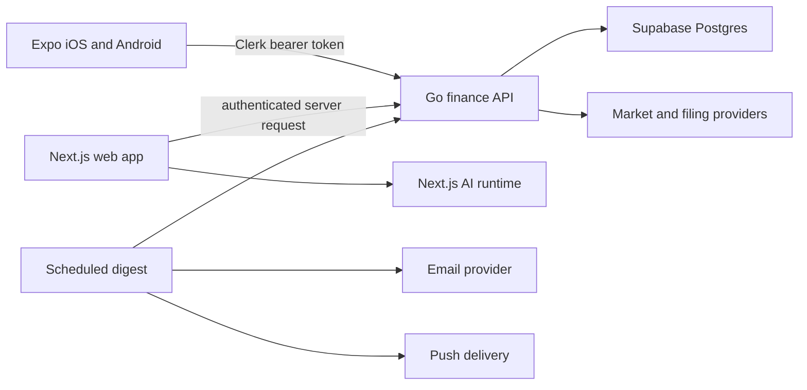

# Aperture Mobile App: Scope And Architecture

Status: scoped proposal. Native app implementation is queued behind the active Product Simplification Track in `docs/MASTER_EXECUTION_ROADMAP.md`. The mobile plan can start sooner if the user explicitly changes that order.

## Decision

Build one **Expo/React Native** app in `apps/mobile` for iOS and Android. Design and test the first slice on iOS, then require Android parity before calling the mobile v1 complete. Use Expo Router for native navigation and EAS development builds for device testing. This is a native companion to the existing Next.js product, with one account and one source of financial data, rather than a WebView copy of the website. Expo supports a shared iOS/Android codebase and native builds; Clerk has an Expo SDK for the existing identity system. [Expo Router](https://docs.expo.dev/router/introduction/), [EAS Build](https://docs.expo.dev/build/introduction/), [Clerk Expo quickstart](https://clerk.com/docs/expo/getting-started/quickstart).

## Product Scope

Keep the same five destinations as the web product:

| Destination | Mobile v1 job | Initial slice |
| --- | --- | --- |
| Overview | See the current financial picture, goal context, and freshness | Summary cards after sign-in |
| Markets | Search/filter supported asset classes and inspect confirmed monitor states | First fully functional screen |
| Portfolio | Review owner-scoped holdings, allocation, and concentration | Read-only first, editing after API parity |
| Plan | Review and adjust stored goal/scenario assumptions | After owner-scoped Plan persistence exists |
| Learn | Continue lessons and contextual education | Lightweight native reader |

The first installable alpha is narrower: sign-in, Markets, a market detail, notification inbox and preferences, and an Overview summary. Later slices add Portfolio, Plan, Learn, and saved cited research. Billing administration, document upload/review, complex charts, and live AI generation stay on the web until their native API and privacy boundaries are defined. The mobile app can open a web workflow for a deliberately deferred task, with clear navigation back to the app.

## Flip Digests And Push

The current email and in-app confirmed-flip digest remains server-generated. The mobile inbox reads the same owner-scoped notifications; device push is a separate, optional delivery channel. This avoids running market scans on a phone or duplicating the flip calculation. A push should say only that a new market digest is available on the lock screen; the signed-in app loads the symbols, source timestamps, coverage gaps, and research-only disclaimer.

Add an owner-scoped device registration endpoint, a separate push opt-in preference, token rotation/revocation, and a server-side send/receipt path. One digest produces at most one push per registered device; disabling push or signing out unregisters that device. Push permission is requested when the user enables it, not during onboarding. Expo's push setup requires device permission, push tokens, platform credentials, and a development build; remote push is unavailable in Expo Go. [Expo push setup](https://docs.expo.dev/push-notifications/push-notifications-setup/), [notification behavior](https://docs.expo.dev/push-notifications/what-you-need-to-know/).

## Runtime Boundary

- **Identity:** `@clerk/expo` uses the same Clerk application as the web app. The mobile client sends a short-lived Clerk token to the Go API. Go validates the token and enforces ownership and entitlements on every user-owned resource. Store session material through Clerk's documented secure token cache; do not put JWTs or finance data in plain AsyncStorage. [Clerk Expo quickstart](https://clerk.com/docs/expo/getting-started/quickstart), [Expo SecureStore](https://docs.expo.dev/versions/latest/sdk/securestore/).
- **Finance and market data:** Go remains authoritative for portfolios, goals, normalized market data, signal snapshots, notification preferences, and device registration. The phone never receives provider keys, Supabase service credentials, or raw database access.
- **Web and AI:** Next.js retains marketing, web UI, AI orchestration, streaming, and webhooks. The first mobile release can read saved, cited research through owner-scoped APIs. Native AI streaming requires a separate authenticated bearer-token entry point with the same tool, safety, usage, and citation checks as the web flow; it is not part of the first alpha.
- **Contracts:** Expand `packages/contracts/openapi/finance-api.yaml` for mobile-facing routes and generate a typed client under `packages/contracts`. Share API schemas and pure presentation models, not Next.js components or server-only provider code.
- **Device storage:** Cache only bounded public market context at first. Private holdings, prompts, research text, and notification details require explicit encrypted-cache and deletion rules before offline storage is added. Clear in-memory private state on sign-out.

## API Gaps To Close Before A Useful Alpha

1. **Canonical market signals:** The web's Adaptive Supertrend calculation and crypto monitor aggregation currently live in `apps/web/src/lib`. The Go `/v1/market-monitors/{class}` route does not yet provide the same confirmed-flip contract. Move or reproduce that authoritative calculation behind a versioned Go signal endpoint, and compare Go results against existing TypeScript candle fixtures. Return timeframe, trend, confirmed last flip, next flip level, signal basis, provider, captured/closed time, history coverage, and partial failures. The web and mobile clients then consume the same result.
2. **Owned Overview and Plan reads:** Define and persist the income, expense, goal, and scenario contracts already required by the active Product Simplification Track. Mobile should not depend on web-local state or fixture-only summaries.
3. **Notification delivery:** Finish applying and live-verifying the flip-digest migration and server configuration from `docs/ENVIRONMENT.md`. Add owner-scoped device token APIs and push delivery only after that base flow is operational.
4. **Mobile authentication:** Verify Clerk Expo tokens against the Go JWT middleware in a real development build. Document issuer, audience, token refresh, sign-out, and expired-session behavior. Keep public Go access behind TLS, rate limits, and Cloudflare controls.
5. **Saved research:** Add compact owner-scoped read contracts for approved briefs and citations before surfacing them natively. Never move model credentials or unrestricted AI tools into the app.

## Delivery Sequence And Gates

| Slice | Deliverable | Acceptance gate |
| --- | --- | --- |
| M0. API readiness | Shared confirmed-signal, Overview, digest, and auth contracts | Web and mobile can consume identical source-aware values; ownership and stale-data tests pass |
| M1. Native foundation | Expo app, brand tokens, iOS navigation, Clerk sign-in, API client | Sign-in/out and token expiry work on a physical iPhone; no secret or private data leaks |
| M2. First useful alpha | Markets search/filter/detail, Overview, digest inbox/settings | Closed-candle flips match web; provider gaps and disclaimers render; iOS development build works |
| M3. Cross-platform v1 | Portfolio, Plan, Learn, Android layouts and device tests | Five destinations work on both platforms; Android and iOS parity and accessibility checks pass |
| M4. Push and release | Consent, device registration, server push, deep links, release builds | One digest creates at most one push per device; opt-out and sign-out revoke delivery; store builds pass review |

Use iOS as the design and device-testing lead, not as a separate codebase. Verify Android on every slice from M2 onward. Both platforms need native text scaling, screen-reader labels, safe-area handling, offline/error states, and contrast checks.

## Release Guardrails

- Signals, push copy, AI output, and scenario screens remain research and decision support. No trade execution, buy/sell instructions, suitability claims, or return promises.
- Every market or AI view shows source and freshness; gaps and stale data remain visible. AI and scenario views show assumptions, citations where available, and the not-financial-advice notice.
- Push payloads and analytics contain no holdings, financial amounts, email addresses, prompts, AI outputs, raw JWTs, or private research.
- Billing entitlements come from the backend. Native subscription purchase and store-policy work require a separate scoped decision before implementation.
- No external model calls are enabled by mobile development. The existing paid-provider kill switch remains off by default.

## Planned Files

`apps/mobile/` for the Expo app; `packages/contracts/` for shared API types; `services/api/` for canonical signals and device APIs; `supabase/migrations/` for owner-scoped device records; and `docs/` for release, privacy, and testing instructions. No mobile app files are created by this planning task.
