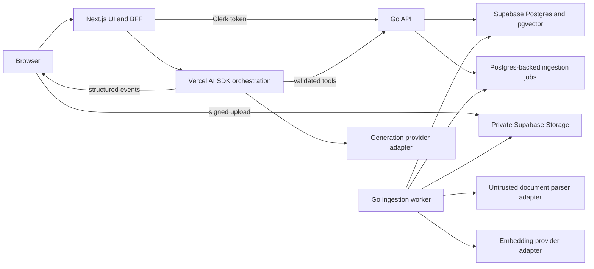

# Repository Assessment

Assessment date: 2026-07-23

Upgrade phase: 0 - repository assessment and migration design

Primary guidance: existing-project redesign audit

Supporting guidance: Supabase security and persistence review

Scope: analysis only. No runtime behavior, dependency, schema, route, or UI implementation is changed by this assessment.

## Current Architecture

### Framework and versions

The repository is a small monorepo with three runtime boundaries:

| Area | Current implementation |
| --- | --- |
| Web | Next.js 16.2.6 App Router, React 19.2.4, TypeScript 5, Tailwind CSS 4, shadcn/Radix primitives |
| AI orchestration | Vercel AI SDK 6.0.191, `@ai-sdk/openai` 3.0.65, Zod 4.4.3 |
| Finance API | Go 1.23.4, standard `net/http`, `pgx` 5.7.2, handwritten Clerk RS256/JWKS verification |
| Data | Supabase Postgres 17 configuration, SQL migrations, `pgvector` enabled with 1,536-dimension embeddings |
| Authentication | Clerk in Next.js; Clerk JWT verification or a non-production `dev:` token in Go |
| Billing and telemetry | Stripe/Clerk webhook handlers, Supabase REST persistence helpers, optional Upstash/PostHog/Sentry integrations |

The intended request boundary is sound: the browser talks to Next.js, Next.js acts as the BFF and AI UX layer, and Go owns authoritative finance/data APIs. That boundary should remain in place during the upgrade. The TypeScript-first suggestion in the upgrade brief should not replace the documented Go backend decision.

### Current route structure

Public routes:

- `/`
- `/product`
- `/pricing`
- `/security`
- `/blog`
- `/privacy`
- `/terms`
- `/sign-in`
- `/sign-up`

Authenticated app routes:

- `/app`
- `/app/portfolio`
- `/app/research`
- `/app/goals`
- `/app/watchlist`
- `/app/risk`
- `/app/settings`
- `/app/settings/account`
- `/app/billing`

Next.js route handlers:

- AI: portfolio brief, research brief, goal plan, and risk explainer
- Finance BFF: portfolio, watchlist, and intraday market data
- Persistence: research saves
- Webhooks: Clerk and Stripe

Go exposes health, identity, usage, asset search/quote/intraday, portfolio CRUD/holdings, and watchlist APIs under `/v1`.

There are no workspace, uploaded-document, parsing-job, retrieval, analysis-run, citation-review, approval, feedback, evaluation-results, or export APIs.

### Database and persistence

Supabase migrations define a broad domain model for profiles, billing, portfolios, assets, watchlists, research documents/chunks, AI records, goals, audits, and usage. RLS is enabled, and `pgvector` is installed.

The runtime does not yet match the documented architecture:

- The Go service does not read `DATABASE_URL`, open the `pgx` pool, or instantiate generated `sqlc` queries.
- Portfolio and watchlist state lives in `WorkspaceStore`, an in-memory map that is lost on process restart.
- `sqlc.yaml` exists, but only asset queries are defined and generated query code is not present.
- Next.js writes selected AI, billing, webhook, and audit data directly through the Supabase REST API with a server-side service-role key.
- `research_documents` is asset-oriented rather than workspace-owned.
- `research_documents` and `research_chunks` currently have globally readable RLS policies.
- Supabase Storage is enabled locally, but no private document bucket, object-key convention, upload policy, or lifecycle policy exists.

### Authentication

Clerk protects `/app(.*)` when runtime keys are configured. The protected layout also checks Clerk configuration, and server routes obtain a Clerk session token. The Go service validates RS256 Clerk tokens against JWKS in production mode and supports a development-only owner token outside production.

The ownership model is incomplete for the proposed document workspace:

- There is no workspace owner entity.
- Research documents and chunks do not carry a user/workspace ownership path.
- The current RLS session mechanism uses `app.current_profile_id`, but the Go request path never opens a database transaction or sets it.
- Several Next.js server helpers use the service-role key, which bypasses RLS by design and therefore depends entirely on correct application filtering.

### AI integrations

The strongest implemented AI path is the portfolio brief:

- external calls are disabled by default;
- a provider/model selector supports direct OpenAI and Vercel AI Gateway;
- Zod validates structured portfolio output;
- owner-scoped portfolio context is obtained through an application tool wrapper;
- safety prechecks reject direct trade, guaranteed-return, prompt-extraction, and cross-user requests;
- optional persistence records threads, messages, tool runs, citations, usage, model, and latency.

The research, goal, and risk routes remain deterministic fixtures. The research route does not parse uploaded files, generate embeddings, query `pgvector`, validate claim-to-chunk coverage, or invoke a live model. The current provider abstraction covers model selection only; it does not provide common interfaces for embeddings, retries, fallback, cancellation, or normalized usage reporting.

The portfolio route contains a text-streaming branch, but explicit `AI_PORTFOLIO_BRIEF_MODE=live` currently rejects streaming before that branch, and no shipped client consumes the stream into structured sections. The product therefore does not yet demonstrate the upgrade plan's streaming workflow.

### Document handling

There is no user document upload or processing implementation.

Existing document-related artifacts are limited to:

- `research_documents` and `research_chunks` tables;
- two seeded SEC-style fixture chunks;
- deterministic in-code filing fixtures;
- a static research page that renders those fixtures.

Missing capabilities include file validation, private storage, malware scanning, PDF/text extraction, page preservation, chunking, stable chunk IDs, embedding generation, indexing, retryable jobs, processing status, and deletion.

### Testing setup

Current checks pass:

- `go test ./...`
- `npm run lint`
- `npm run build`
- `scripts/run-ai-evals`
- `scripts/check-ai-safety-fixtures`
- `scripts/validate-supabase-migrations`
- `scripts/verify-phase7-security`

Coverage is narrow:

- Go tests exist only for authentication/JWKS and HTTP handlers.
- There are no TypeScript unit or component tests.
- There is no Playwright or equivalent end-to-end setup.
- The AI eval scripts validate hand-authored JavaScript objects and regular expressions, not the real retrieval/generation pipeline.
- Migration validation is static text inspection rather than applying migrations and testing policies.
- There is no CI workflow in `.github/workflows`.

### Deployment setup

The web app has a minimal Vercel configuration. The intended Go target is documented as Cloud Run, Fly.io, or Railway, but the repository has no Dockerfile, service manifest, health deployment check, background worker entry point, or infrastructure configuration. Supabase remote application, Clerk/Stripe webhook delivery, Upstash, PostHog, Sentry, and Cloudflare remain environment-dependent.

### Design-system conventions

The current UI already has a distinctive dark, cyan/amber, metal-and-glass visual system with Outfit typography, tabular/monospace data treatment, responsive app navigation, semantic page regions, focus treatments, reduced-motion CSS, and composed empty/error states on portfolio and watchlist surfaces.

The product is already card/workspace-first rather than a generic full-screen chatbot. The upgrade should evolve the research route into a three-part evidence workspace without redesigning the entire site.

Material UX gaps against the new plan are:

- navigation is portfolio-centric rather than research-workspace-centric;
- there is no active navigation state;
- the research route has no workspace/document/history/evaluation hierarchy;
- citations are static cards rather than interactive claim-to-evidence links;
- no upload, processing, streaming, cancellation, retry, partial, degraded, approval, or export states exist;
- several controls report acceptance in local fixture mode without proving durable persistence;
- the app uses Lucide icons exclusively, which reduces brand differentiation but is lower priority than functional trust states.

### Major technical debt

1. The documented Postgres system of record is not wired into the Go runtime.
2. Portfolio and watchlist mutations are process-local and non-durable.
3. User-uploaded research has no tenant boundary; current research rows are readable by all database sessions allowed through the policy.
4. The app describes real AI capabilities that only the portfolio path partially implements.
5. AI persistence is split across direct service-role REST calls rather than one authoritative application API.
6. There is no durable job or idempotency model for ingestion.
7. No vector index or owner-filtered retrieval function exists.
8. There is no browser-level test suite or CI gate.
9. `services/api/main.go` duplicates `services/api/cmd/api/main.go`.
10. Several settings and save interactions are presentation-level controls rather than durable product behavior.

## Existing Strengths

- The product boundary is clear: research and decision support, never trade execution or personalized advice.
- The documented Next.js/Go/Supabase separation is appropriate for a recruiter-grade product and should be preserved.
- Clerk route protection and Go JWT verification provide a credible authentication base.
- Finance API handlers already demonstrate owner-scoped behavior and structured errors.
- The provider layer already separates market-data providers and includes fallback behavior.
- The web app uses server components for read-heavy routes and client components for interactions.
- AI output schemas, finance-safety checks, rate limits, entitlements, audit helpers, and telemetry scrubbing are useful foundations.
- The existing database includes AI usage, tool run, citation, and evaluation concepts that can be evolved rather than discarded.
- The visual system is more mature than the new plan assumes and can support the evidence workspace without a wholesale redesign.
- The clean baseline build gives the upgrade a stable starting point.

## Gaps Against Product Plan

| Product-plan capability | Current state | Gap |
| --- | --- | --- |
| Research workspaces | No workspace entity or route | Add owner-scoped workspace model, APIs, navigation, and selection |
| PDF/text upload | Not implemented | Add type/size/magic-byte validation and private direct upload |
| Object storage | Supabase Storage enabled only | Add private bucket, signed upload/download, path rules, and cleanup |
| Parsing and page metadata | Not implemented | Add retryable page-aware extraction pipeline |
| Chunking | Two static fixture chunks | Add deterministic heading/page-aware chunker with stable IDs |
| Embeddings/vector search | Schema field only | Add provider abstraction, vector index, owner-filtered query, and diagnostics |
| Structured analysis | Portfolio schema exists | Add workflow-specific schemas and validated section persistence |
| Streaming UX | Server branch only | Stream named stages and structured sections to a client state machine |
| Citations/evidence | Static fixture cards | Add claim-to-chunk validation and interactive evidence panel |
| Uncertainty | Generic confidence enum | Replace fake precision with strong/mixed/limited/none evidence states |
| Cancel/retry/regenerate | Not implemented | Add abort propagation, durable cancellation, and section retry |
| Approval | Save route is not approval | Add explicit edit/accept/reject flow with append-only history |
| Cost/latency | Partial portfolio metadata | Persist normalized model/provider/token/cost/stage latency for every run |
| Evaluation suite | Nine static checks | Build 30-50 source-backed cases and store comparable results |
| Degraded/error states | Some generic errors | Add upload, parsing, retrieval, provider, validation, cancellation, and partial states |
| Accessibility | Good baseline CSS | Add live-region streaming announcements, evidence labels, dialog/table QA, and keyboard flow tests |
| Deployment | Web-only config | Add API/worker container and release checks |

## Proposed Architecture

### Architecture decision

Keep the existing architecture and add a document-research vertical slice:

Responsibility split:

- Next.js owns the three-pane workspace, upload UX, signed-upload BFF, structured streaming UI, cancellation controls, and AI orchestration.
- Go owns workspace/document authorization, document metadata, processing jobs, parsing orchestration, chunk persistence, retrieval, citation validation inputs, approval mutations, evaluation persistence, and audit-backed writes.
- Supabase Postgres remains the system of record and `pgvector` store.
- Supabase Storage holds original uploads in a private bucket. Store object keys, not reusable public URLs.
- A Go worker process uses the same module as the API but has a separate command. It claims jobs from Postgres with `FOR UPDATE SKIP LOCKED`, avoiding a new queue dependency in the first milestone.
- AI providers remain disabled by default locally. Production evidence workflows require a real embedding and generation provider; fixtures may support tests but cannot be presented as final functionality.

### Request flow

1. Next.js asks Go to create an owner-scoped pending document and upload intent.
2. Next.js returns a short-lived signed Storage upload URL.
3. The browser uploads directly to the private bucket.
4. Next.js tells Go to finalize the upload with size, hash, and MIME metadata.
5. Go validates ownership and enqueues an idempotent processing job.
6. The worker verifies the stored object, scans/validates it, extracts page-aware text, chunks it, creates embeddings, and updates document status.
7. Analysis requests create an `analysis_run`; retrieval is filtered by the authenticated workspace and selected documents before vector search.
8. Next.js streams named progress events and validated sections from the model.
9. Citations are validated against the retrieved chunk allow-list before display.
10. Editing and approval call Go mutations. The raw output remains immutable; edits and approval events are stored separately.

### Dependency Proposal

No dependencies should be added during assessment. Add later dependencies only in the commit that first uses and tests them.

Recommended additions:

| Dependency area | Proposal | Reason |
| --- | --- | --- |
| Vector support in Go | `pgvector-go` with `pgx` | Typed vector parameters/results for owner-filtered retrieval |
| PDF parsing | Select behind a `DocumentParser` interface after a fixture-based spike | Go PDF extractors vary significantly in page fidelity; selection must be evidence-based |
| Web unit/component tests | Vitest, Testing Library, `user-event`, and MSW | Exercise schemas, state transitions, upload UI, streaming reducers, and API failures |
| Browser tests | Playwright | Cover upload through approval/export and accessibility-critical flows |
| Markdown display, only if needed | `react-markdown`, `remark-gfm`, and `rehype-sanitize` | Strictly sanitize user/model Markdown; prefer structured React rendering first |

Prefer existing platform capabilities over new packages:

- use Supabase Storage rather than adding another object store;
- use a Postgres job table before adding Redis or a queue framework;
- use native `AbortController` for cancellation;
- generate Markdown export deterministically without a library;
- use the existing AI SDK and OpenAI provider package for generation and embeddings behind local interfaces;
- do not add TanStack Query until cache invalidation or optimistic synchronization demonstrably needs it.

The PDF parser and malware-scanning mechanism remain explicit selection gates. A parser must pass page-number, ordering, malformed-file, and hidden-content fixtures. Production upload should integrate ClamAV or an equivalent scanner before processed content is trusted.

## Data Model Changes

Do not delete the existing portfolio model. Evolve the research tables through additive migrations and backfill before tightening constraints.

### New or renamed domain entities

`research_workspaces`

- `id`, `user_id`, `name`, `description`
- `model_settings` with a server-validated allow-list
- timestamps and archived state

`research_documents` additions

- `workspace_id`, `uploaded_by`
- `original_filename`, `mime_type`, `byte_size`, `sha256`
- `storage_bucket`, `storage_object_key`
- `status`, `attempt_count`, `error_code`, sanitized `error_message`
- `page_count`, `uploaded_at`, `parsed_at`
- preserve current asset/SEC fields as optional provenance for provider-ingested filings

`document_pages`

- `document_id`, `page_number`, normalized text, text hash, character count
- unique `(document_id, page_number)`

`research_chunks` additions

- `workspace_id`, `page_number`, `sequence`
- `heading_path`, `stable_key`, `content_hash`
- character offsets, embedding model/dimensions/version
- created and reprocessed timestamps

`document_processing_jobs`

- document, job type, status, attempts, lease owner/expiry, next retry time
- idempotency key, safe error code/message, stage timings

`analysis_runs`

- workspace, workflow, query, selected document IDs
- model/provider/mode, status, stage, start/completion/cancellation times
- token usage, estimated cost, latency, error code, schema version, prompt version
- retrieved chunk IDs and retrieval timing

`analysis_sections`

- run, section type/order
- immutable raw output, validated output, user-edited output
- validation and evidence state

`analysis_citations`

- section, claim ID, chunk ID, excerpt snapshot, retrieval score
- validation status and validation reason

`analysis_approval_events`

- section, actor, action, edited content snapshot, timestamp
- append-only history for proposed, edited, approved, rejected, and revoked states

`analysis_feedback`, `evaluation_cases`, and `evaluation_results`

- structured feedback categories
- versioned dataset/build/model/prompt/retrieval identifiers
- correctness, citation, unsupported-claim, schema, latency, cost, and injection-resistance metrics

### Ownership and RLS

- Replace global research-document/chunk read policies with workspace-owner policies before user uploads are enabled.
- Create a non-`BYPASSRLS` database role for the Go API and set `app.current_profile_id` with `SET LOCAL` inside every authenticated transaction.
- Keep service-role access limited to explicit server-only webhook/administrative paths.
- Add private Storage policies or keep Storage operations service-mediated with short-lived signed URLs.
- Include workspace filters inside every vector query; do not rely on vector IDs returned by the model.

## API and AI Layer Changes

### Go API

Add versioned endpoints in milestone order:

- workspace list/create/read/update/archive;
- document create-upload-intent/finalize/list/read/retry/delete;
- processing status;
- retrieval search with workspace/document filters and diagnostics;
- analysis-run metadata and history;
- section edit/approve/reject;
- citation-report and feedback;
- evaluation summaries;
- Markdown export of reviewed content.

All mutations require Clerk auth, explicit ownership checks, request validation, rate limits where appropriate, audit events, and idempotency for upload finalization and job creation.

### AI and retrieval

- Introduce interfaces for generation, embeddings, streaming events, normalized usage, retry classification, and provider fallback.
- Keep tool inputs/outputs schema-validated.
- Treat document text as untrusted evidence, never instructions.
- Record the exact chunk IDs sent to the model.
- Build context only from chunks returned by the owner-filtered retrieval API.
- Validate every citation against that allow-list and active workspace.
- Use deterministic code for financial arithmetic, comparisons, citation coverage, cost calculation, and approval transitions.
- Attempt structured-output repair once, preserve valid sections, then expose a partial/degraded result.
- Stream typed events such as `stage`, `section`, `evidence`, `warning`, `usage`, `complete`, and `error`; do not stream raw token noise as the primary UI.
- Propagate browser abort signals to provider calls and persist cancellation.
- Do not let model tool calls approve, publish, or export findings.

### Workflow contracts

Implement workflows incrementally, starting with earnings review and custom research. Each workflow must version:

- input schema;
- retrieval strategy;
- output schema;
- validation rules;
- rendering component map;
- evaluation tags and minimum scores.

Add risk-factor extraction and period comparison after the first end-to-end workflow is stable. Investment memo drafting should remain a reviewed draft and must preserve the not-financial-advice boundary.

## Frontend Changes

Evolve `/app/research` into a three-pane research workspace:

- left: workspaces, documents, saved analyses, evaluations, settings;
- center: structured analysis sections and workflow controls;
- right: source excerpt, page, retrieval score, citation relationship, and support warning.

Recommended route shape:

- `/app/research`
- `/app/research/workspaces/[workspaceId]`
- `/app/research/workspaces/[workspaceId]/documents/[documentId]`
- `/app/research/workspaces/[workspaceId]/analyses/[analysisId]`
- `/app/research/evaluations`

Required UI state machines:

- upload: idle, validating, uploading, finalizing, queued, parsing, chunking, embedding, ready, failed;
- analysis: idle, preparing, retrieving, drafting, validating, partial, complete, canceled, failed;
- review: proposed, edited, approved, rejected.

Implementation principles:

- reuse the existing dark visual tokens and shell;
- keep the portfolio, watchlist, goal, risk, billing, and public routes working;
- make active navigation visible;
- render structured blocks rather than one chat transcript;
- keep the evidence panel available while generation continues;
- announce streaming stages through an accessible live region;
- support keyboard citation navigation and focus return;
- expose what failed, what was preserved, and the next action in every error state;
- use qualitative evidence states instead of numeric confidence percentages;
- export only through an explicit review dialog that labels approved and unapproved sections.

## Security Risks

Priority 0 blockers before upload:

1. `research_documents_read_all` and `research_chunks_read_all` are incompatible with private user uploads.
2. The runtime does not set the RLS profile context described by the migrations.
3. Service-role REST helpers bypass RLS; new user-owned persistence must not depend on caller-supplied IDs alone.
4. Uploaded files are untrusted binary input and need size, extension, MIME, magic-byte, parser, malware, timeout, and decompression-bomb controls.
5. Storage objects need private access, unpredictable keys, short-lived signed URLs, and deletion consistency.

Priority 1 risks:

- prompt injection and hidden text inside documents;
- cross-workspace vector retrieval caused by a missing filter or join;
- citation IDs invented by a model or reused from another run;
- raw document excerpts, prompts, holdings, or findings leaking into logs and error monitoring;
- duplicate finalize/retry requests creating duplicate chunks or charges;
- provider retries causing repeated billable generations;
- stale approval after a section is regenerated;
- unsafe Markdown/HTML rendering;
- long-running parsing or model requests exhausting resources;
- exported reports failing to distinguish approved, edited, rejected, and raw content.

Security gates:

- adversarial RLS tests with two users and two workspaces;
- Storage policy tests;
- prompt-injection fixtures embedded in PDFs and text;
- citation allow-list validation;
- audit events for upload, delete, retry, generation, edit, approval, rejection, export, and citation report;
- log-scrubbing tests using realistic document and finance payloads;
- content-security and sanitized-rendering review before Markdown display.

## Testing Gaps

Add a layered test strategy with every implementation commit:

- unit: file validation, page normalization, stable chunk IDs, chunk overlap, schemas, citation mapping, evidence strength, cost calculation, approval transitions;
- Go integration: authenticated workspace/document CRUD, job leasing, storage adapter, retrieval filters, vector query, idempotency, cancellation, and two-user isolation;
- migration: apply from empty database, upgrade from current migrations, verify RLS with non-service roles, inspect indexes and advisors;
- component: upload state machine, processing status, streaming reducer, partial results, evidence panel, review controls, accessible announcements;
- route integration: upload intent/finalize, retrieval-to-generation, structured repair, provider timeout/rate limit, persistence failure, cancel/retry;
- end to end: create workspace, upload document, wait for ready, run analysis, inspect citation, edit, approve, export, and recover from simulated failures;
- AI regression: 30-50 source-backed cases across at least five documents, including unanswerable, conflicting, calculation, comparison, and prompt-injection cases;
- release: build, lint, Go tests, migration reset, contract generation, eval thresholds, secret scan, and browser smoke tests in CI.

The current scripts should remain as fast safety smoke tests, but they should not be reported as model or retrieval quality evaluation.

## Migration Risks

| Risk | Mitigation |
| --- | --- |
| Existing fixture documents have no workspace owner | Create a system fixture workspace or remove only after replacement; backfill before adding `NOT NULL` |
| Tightening research RLS can break current fixture pages | Move fixture display behind an owner-scoped seeded demo workspace first |
| Replacing in-memory portfolio storage expands scope | Wire Postgres before building document jobs so ownership and transaction patterns are proven once |
| Embedding dimension/provider changes | Store model and dimensions; version indexes and re-embed through jobs |
| Duplicate chunks during retry | Stable chunk keys plus unique document/version/sequence constraints |
| PDF parser quality | Run a parser spike against representative annual reports, tables, scans, malformed files, and injected text |
| Serverless timeouts | Keep parsing/embedding in the worker, not the request/response path |
| Direct service-role writes | Move user-owned analysis persistence behind Go APIs in slices, keeping webhooks isolated |
| Current AI records overlap new analysis entities | Add new tables, migrate references deliberately, and avoid an all-at-once rename |
| Streaming and persistence can diverge | Persist run state and accepted sections transactionally; make terminal events idempotent |
| User edits can be overwritten by regeneration | Immutable raw versions and optimistic version checks |
| Cost telemetry drifts as provider pricing changes | Version the pricing table/config used for each estimate |
| Deployment expands from two to three processes | Use one Go module with separate API and worker commands and a shared health/readiness contract |

## Recommended Milestones

### Upgrade Phase 0 - Assessment and roadmap lock

Status: complete when this assessment and the updated master roadmap are committed.

Deliverables:

- repository assessment;
- architecture recommendation;
- dependency proposal;
- migration/security risks;
- phased acceptance gates.

No application implementation is allowed in this phase.

### Upgrade Phase 1 - Foundation

Deliverables:

- document-research architecture decision record;
- durable Go/Postgres request pattern and profile-scoped transactions;
- owner-scoped workspace/document schema and RLS;
- private Storage bucket and upload intent/finalization;
- PDF/text validation and parser adapter;
- Postgres-backed processing jobs and Go worker;
- page-aware parsed output and document status/retry UI.

Acceptance gate:

- a signed-in user can upload a supported PDF or text file;
- status progresses durably and survives process restarts;
- failed processing can be retried idempotently;
- parsed pages retain document, page, heading where available, and source metadata;
- a second user cannot list, read, download, retry, or delete the document;
- no external model call is required yet.

### Upgrade Phase 2 - Retrieval

Deliverables:

- deterministic chunker and stable IDs;
- embedding adapter and versioned embeddings;
- vector index and owner-filtered retrieval API;
- document/workspace filters;
- evidence search UI and developer retrieval diagnostics.

Acceptance gate:

- representative queries return relevant chunks with document/page metadata;
- duplicate chunks are suppressed;
- cross-workspace retrieval tests pass;
- retrieved chunk IDs and stage latency are recorded.

### Upgrade Phase 3 - Structured generation

Deliverables:

- provider-independent generation/embedding contracts;
- first workflow schemas;
- typed structured streaming;
- validation and one repair attempt;
- cancellation, retry classification, usage/cost/latency persistence;
- partial/degraded output.

Acceptance gate:

- an earnings-review or custom-research result streams into structured sections;
- cancellation stops downstream work and is recorded;
- invalid output is repaired once or preserved as an explicit partial result;
- tokens, cost estimate, latency, model, provider, prompt version, and retrieved chunks are stored.

### Upgrade Phase 4 - Citations and trust

Deliverables:

- claim-to-chunk mapping;
- citation validation;
- interactive evidence panel;
- unsupported-claim warnings;
- qualitative evidence strength and citation coverage.

Acceptance gate:

- every material finding shows valid support or an unsupported warning;
- citation activation reveals the correct excerpt and page;
- no citation can resolve outside the run's workspace and retrieved-chunk allow-list.

### Upgrade Phase 5 - Review and approval

Deliverables:

- edit, accept, reject, and section regenerate;
- append-only approval history;
- incorrect-citation feedback;
- reviewed Markdown export.

Acceptance gate:

- model output cannot approve itself;
- raw and user-edited content remain distinct;
- stale approvals are invalidated when content changes;
- export clearly identifies approval state and evidence.

### Upgrade Phase 6 - Evaluation, accessibility, and release polish

Deliverables:

- 30-50 case evaluation dataset using at least five documents;
- stored per-build/model results and comparison dashboard;
- prompt-injection and cross-workspace suites;
- end-to-end tests and CI;
- WCAG 2.2 AA-focused pass;
- API/worker deployment artifacts and updated portfolio case study.

Acceptance gate:

- structured output always validates after repair or degrades explicitly;
- no cross-workspace retrieval occurs;
- supported workflows contain no uncited material factual claims;
- every consequential action requires approval;
- core upload-to-export flow passes end to end;
- known failure modes and production configuration are documented.

### Commit discipline for implementation

- One behavior per commit where practical: schema, API, worker stage, UI state, or test/eval behavior.
- Include the relevant tests in the same commit as the behavior.
- Keep migrations append-only and commit each independently reviewable migration with its validation.
- Create a milestone-completion documentation commit only after its acceptance gate passes.
- Do not combine formatting, dependency upgrades, or unrelated cleanup with a feature commit.

## Files Likely to Change

Existing control-plane documentation:

- `docs/MASTER_EXECUTION_ROADMAP.md`
- `docs/ARCHITECTURE.md`
- `docs/DATABASE_SCHEMA.md`
- `docs/API_SPEC.md`
- `docs/AI_FEATURES.md`
- `docs/AI_INTEGRATION_AND_DEV_SETUP.md`
- `docs/SECURITY_AND_COMPLIANCE.md`
- `docs/TESTING_STRATEGY.md`
- `docs/ENVIRONMENT.md`
- `README.md`

Database and contracts:

- new append-only files under `supabase/migrations/`
- `services/api/sqlc.yaml`
- new queries under `services/api/sql/queries/`
- generated `services/api/internal/db/dbqueries/`
- `packages/contracts/openapi/finance-api.yaml`
- `packages/contracts/src/generated/client.ts`
- `scripts/generate-openapi-client`
- `scripts/validate-supabase-migrations`

Go API and worker:

- `services/api/internal/config/config.go`
- `services/api/internal/db/db.go`
- `services/api/internal/httpapi/server.go`
- `services/api/internal/httpapi/server_test.go`
- new packages under `services/api/internal/workspaces/`, `documents/`, `jobs/`, `parsing/`, `retrieval/`, `analysis/`, and `storage/`
- new `services/api/cmd/worker/main.go`
- one canonical API entry point under `services/api/cmd/api/`
- new container/deployment files for API and worker

Next.js routes and UI:

- `apps/web/src/components/app-shell.tsx`
- `apps/web/src/app/app/research/page.tsx`
- new dynamic routes under `apps/web/src/app/app/research/`
- new handlers under `apps/web/src/app/api/research/` and `apps/web/src/app/api/ai/`
- new research components under `apps/web/src/components/research/`
- new server clients under `apps/web/src/lib/research/`
- `apps/web/src/lib/ai/model-provider.ts`
- `apps/web/src/lib/ai/persistence.ts` during migration to Go-owned persistence
- workflow schemas and streaming state under `apps/web/src/lib/ai/`
- `apps/web/src/app/globals.css`
- `apps/web/package.json` and lockfile only when a dependency is justified by its first use

Tests, evals, and delivery:

- new TypeScript/component test configuration and test files
- new Playwright configuration and end-to-end specs
- source documents and expected outputs under a dedicated evaluation-fixtures directory
- `scripts/run-ai-evals`
- new migration/RLS/storage verification scripts
- new CI workflows under `.github/workflows/`

## Open Questions

These questions do not block the assessment. They must be resolved in the Upgrade Phase 1 ADR before implementation choices become expensive.

1. Should a research workspace be completely independent from portfolios, or optionally link to one portfolio?
2. Which five license-safe financial documents should form the first evaluation dataset?
3. What maximum file size, page count, document count per workspace, and retention period should each plan allow?
4. Should scanned PDFs be rejected in v1, or should OCR be a required fallback?
5. Which PDF parser passes the representative fixture spike with acceptable page and heading fidelity?
6. Which malware-scanning mechanism is available in the intended worker deployment?
7. Is direct OpenAI spend approved later for embeddings and generation, or must the provider abstraction initially target another configured provider?
8. Should the first live workflow be earnings review or a custom research question?
9. Does Markdown export remain local download only, or is a saved export artifact required?
10. Should evaluation cases and diagnostics be visible only in development or to a future admin role?
11. Which Go deployment target and worker process model should be standardized?
12. Are existing deterministic research fixtures retained as explicitly labeled test data or replaced entirely by the evaluation corpus?

Assumptions used in this assessment:

- The repository's Go backend decision and security rules remain authoritative.
- Supabase remains the relational and vector system of record.
- Supabase Storage is the preferred object store for the first upgrade release.
- External model spend stays disabled until explicitly approved.
- Existing public, portfolio, watchlist, goal, risk, billing, and authentication behavior must remain functional throughout migration.
- The first implementation phase ends at durable page-aware document processing; retrieval and generation remain later phases.
